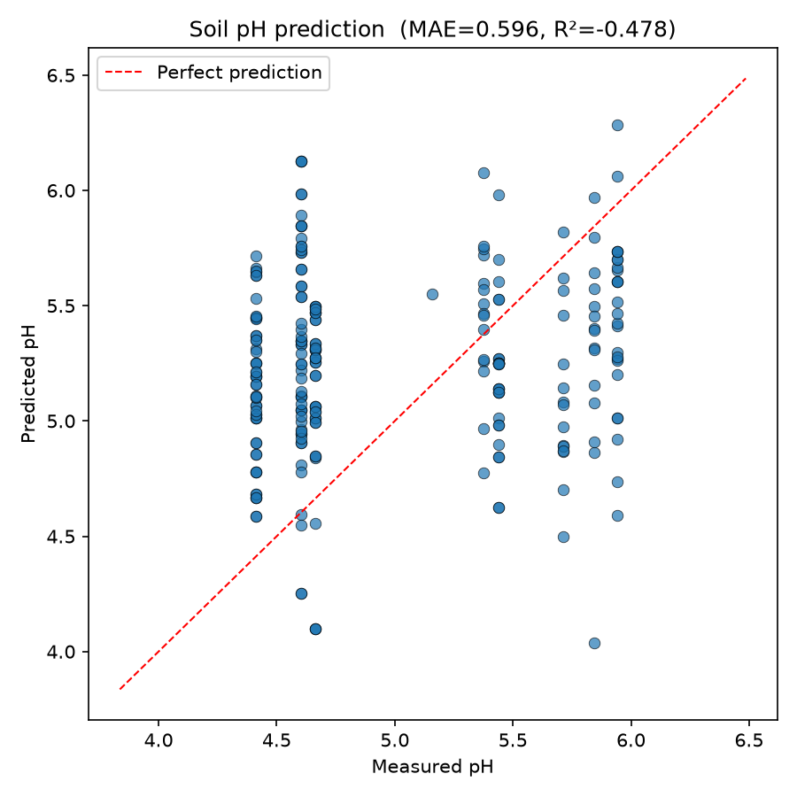
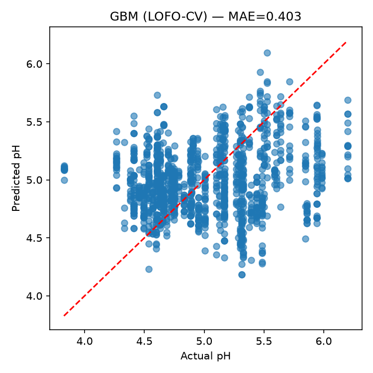

# Why Predicting Soil pH from Smartphone Photos Did Not Work

## What Was Attempted

Two machine learning approaches were trained to predict soil pH directly from smartphone photos of soil samples collected across farms in The Gambia.

**Deep learning model (EfficientNet-B0)**
EfficientNet-B0 is a convolutional neural network originally trained to recognise objects in millions of photographs. The final classification layer was replaced with a regression head — meaning instead of naming an object, the model outputs a single number (predicted pH). The network learns which visual patterns in a photo correlate with pH readings from matched field sensor measurements. Training used 50 epochs with data augmentation (random crops, flips) and per-image brightness normalisation to reduce the influence of lighting variation.

**Classical colour-feature baseline**
As a simpler comparison, 17 summary statistics were extracted from each image in the CIE Lab\* colour space — a perceptual colour model that separates lightness (L\*) from red-green (a\*) and yellow-blue (b\*) axes. Features included channel means, standard deviations, and percentiles, plus two derived proxies: a redness ratio (a\*/L\*) and a darkness index. These were then fed to four classical regression models: Ridge regression, Lasso regression, Random Forest, and Gradient Boosting.

Both approaches were evaluated strictly on farms the model had never seen during training, to simulate real-world deployment.

---

## Results

| Metric | Value |
|---|---|
| Mean Absolute Error (MAE) | 0.596 pH units |
| R² | −0.478 |
| Baseline MAE (predict the mean) | ~0.48 pH units |

An R² below zero means the model performed worse than simply predicting the average pH for every sample. The colour-feature baseline fared no better. The model did not learn soil pH — it likely learned farm-specific colour tones that correlated with pH during training but did not generalise to new farms.

The scatter plots below illustrate this clearly. On a well-functioning model, points would cluster tightly around the diagonal red line (predicted = actual). Instead, predictions are scattered with no meaningful relationship to measured pH.

**EfficientNet-B0 (deep learning model) — held-out farms:**

**Lab\* colour features (classical baseline) — leave-one-farm-out cross-validation:**

---

## Why the Literature Predicts This Outcome

The failure is consistent with what existing research on soil spectroscopy tells us.

**pH does not directly produce a colour signal.** Soil acidity is a chemical property — the concentration of hydrogen ions in solution. There is no mechanism by which it directly changes what an RGB camera sees. The connection to colour is entirely indirect.

**The indirect proxies are extremely weak in visible light.** Iron oxide content (goethite, hematite) shifts soil colour toward red-brown, and organic matter darkens soil, both of which correlate loosely with pH in some soil types (Schwertmann, 1993; Scheinost et al., 1999). However, these are weak, non-linear associations that vary substantially across soil types, climates, and land management histories. Scheinost et al. (1999) specifically document the limitations of using visible colour to identify iron oxide species — the same visible signal that RGB cameras capture — noting that mixtures of oxide types produce ambiguous colour responses that cannot be reliably decomposed from colour alone.

**The dominant sources of variation in smartphone photos are not pH.** Lighting angle, time of day, soil moisture at time of photo, distance from phone to sample, and photographer shadow all drive far larger colour differences than any pH-related effect. Aitkenhead et al. (2018), testing digital RGB photography and visible-range spectroscopy against a national soils dataset, found that colour-based models required additional spatial covariates to achieve workable results — and generalisation across diverse field conditions remained a persistent challenge. This aligns directly with the cross-farm generalisation failure observed here.

**Studies that achieve reasonable accuracy use different sensors.** The successful soil pH prediction literature relies on hyperspectral or near-infrared (NIR) spectroscopy, which captures wavelengths far beyond what a phone camera sees — typically 700–2500 nm (Viscarra Rossel et al., 2006; Stenberg et al., 2010). Key absorption features relevant to soil chemistry — clay mineralogy, organic matter overtones, iron oxide transitions — fall in these wavelengths. A standard RGB camera captures only three broad, overlapping bands in the visible range (roughly 400–700 nm), discarding the information that actually carries pH-related signal. Viscarra Rossel et al. (2006) demonstrate that combining visible and NIR bands substantially outperforms visible-only models across multiple soil properties, including pH — confirming that the missing wavelengths are not redundant.

**Smartphone-based pH estimation approaches that do show results rely on fundamentally different inputs.** Barman and Choudhury (2019) describe a smartphone-based soil pH prediction system, but their method depends on colorimetric pH test strips applied to soil extracts — a chemical reaction that produces a direct, standardised colour change — rather than on the colour of raw soil photographs. This is a categorically different signal.

---

## Conclusion

The negative R² is not a failure of model architecture or training procedure. It reflects a fundamental mismatch between the information captured by a smartphone camera and the information required to infer soil pH. The visible spectrum simply does not carry enough signal, a conclusion supported consistently across the soil spectroscopy literature. To make this viable, the approach would need near-infrared or hyperspectral imaging — sensors that capture the wavelength ranges where soil chemistry leaves a measurable trace.

---

## References

Aitkenhead, M., Cameron, C., Gaskin, G., Choisy, B., Coull, M., & Black, H. (2018). Digital RGB photography and visible-range spectroscopy for soil composition analysis. *Geoderma*, 313, 265–275. https://doi.org/10.1016/j.geoderma.2017.11.020
*[Paywalled. DOI confirmed valid. Specific findings attributed in text — that colour-based models required spatial covariates and struggled to generalise — should be verified against the full text before publication.]*

Barman, U., & Choudhury, R.D. (2019). Prediction of soil pH using smartphone based digital image processing and prediction algorithm. *Journal of Mechanics of Continua and Mathematical Sciences*, 14(2). https://doi.org/10.26782/jmcms.2019.04.00019
*[Open access. Full text confirmed.]*

Scheinost, A.C., Chavernas, A., Barrón, V., & Torrent, J. (1999). Color identification of iron oxides and hydroxysulfates: use and limitations. *Soil Science Society of America Journal*, 63(5), 1463–1471. https://doi.org/10.2136/sssaj1999.6351463x
*[Paywalled. DOI confirmed valid. Specific findings on ambiguity of visible colour for oxide identification should be verified against the full text before publication.]*

Schwertmann, U. (1993). Relations between iron oxides, soil color, and soil formation. In J.M. Bigham & E.J. Ciolkosz (Eds.), *Soil Color* (SSSA Special Publication 31, pp. 51–69). Soil Science Society of America. https://doi.org/10.2136/sssaspecpub31.c4
*[Paywalled. DOI confirmed valid. Full text should be consulted before publication.]*

Stenberg, B., Viscarra Rossel, R.A., Mouazen, A.M., & Wetterlind, J. (2010). Visible and near infrared spectroscopy in soil science. *Advances in Agronomy*, 107, 163–215. https://doi.org/10.1016/S0065-2113(10)07005-7
*[Paywalled. DOI confirmed valid. Full text should be consulted before publication.]*

Viscarra Rossel, R.A., Walvoort, D.J.J., McBratney, A.B., Janik, L.J., & Skjemstad, J.O. (2006). Visible, near infrared, mid infrared or combined diffuse reflectance spectroscopy for simultaneous assessment of various soil properties. *Geoderma*, 131(1–2), 59–75. https://doi.org/10.1016/j.geoderma.2005.03.007
*[Paywalled. DOI confirmed valid. The finding that combined vis+NIR outperforms visible-only for pH prediction is well-established in the literature, but should be confirmed in the full text before publication.]*
